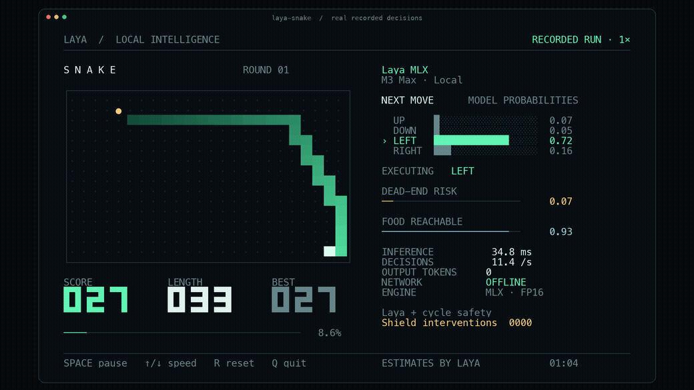

# Laya-MLX



**在 Apple Silicon 上本地运行开放权重的结构化决策模型。**

单个短问题端到端中位耗时 **13.4 ms**；multilingual 检查点为 **7.4 ms**。**0 个输出 token**，原生 MLX，无 PyTorch / Transformers 推理依赖，无云端 API。

[English](README.md) · [完整 benchmark](BENCHMARKS.md) · [Snake 使用说明](docs/SNAKE_DEMO.md) · [30 秒 MP4](docs/assets/snake-demo.mp4)

GIF 使用真实游戏记录按原始时间戳渲染。每步都调用 Laya，界面显示循环路径安全层及其接管次数。上面的 13.4 / 7.4 ms 来自**单问题 API 基准**，并非每步批量回答三个问题的 Snake 帧耗时；游戏速度见[独立报告](docs/SNAKE_BENCHMARKS.md)。

## 快速开始

```bash
pip install laya-mlx
```

```python
import laya_mlx as laya

agent = laya.load("aac6fef/laya-multilingual-mlx")
result = agent.predict(
    "发票被重复扣款，请退款。",
    {
        "department": {
            "type": "choice",
            "instructions": "Who should handle this?",
            "criteria": ["billing", "technical", "sales"],
        }
    },
)
print(result["answers"]["department"])
```

运行贪吃蛇：

```bash
pip install 'laya-mlx[demo]'
hf download aac6fef/laya-multilingual-mlx
laya-snake
```

提前下载一次权重，游戏运行期间完全本地推理。终端至少 104 列 × 35 行；空格暂停、↑/↓ 调速、R 重开、Q 退出。`--max-speed` 持续满速运行，每一步等待新的模型结果。

`laya-snake --optimize --max-speed` 启用已验证的编译与前缀复用路径。同轮成对测试中，2,400 步达到 **75.40 步/秒**，零死亡、安全接管 2 次，比 eager 基线快约 **6.5%**。[完整游戏表现、优化测量和一致性证据](docs/SNAKE_OPTIMIZATION.md)。

## M3 Max 实测

| FP16，端到端 | Laya 421M | Multilingual 322M |
|---|---:|---:|
| 单个短问题 P50 | **13.42 ms** | **7.39 ms** |
| 单个短问题 P95 | **13.92 ms** | **7.79 ms** |
| 50 问题吞吐量 | **146.8 q/s** | **395.0 q/s** |
| 单个短问题 MLX 峰值分配 | **943.6 MiB** | **687.6 MiB** |

硬件为 M3 Max（40 核 GPU、128 GiB 内存）。计时包含提示准备、tokenization、张量构建、GPU 同步推理、校准及结果格式化，排除模型加载。50 问题吞吐量使用 `batch_size=64`，公开 API 默认为 16。

**移植一致性：**三个检查点在 FP32 和 FP16 下均通过 **63/63** 验证问题的上游 argmax 对齐，合计 378/378；每个配置各执行 100 次重复调用，结果有限、确定，测得活跃内存增长为零。它验证移植保真度，不代表所有实际问题都能答对。[完整误差和原始记录](BENCHMARKS.md)。

`choice` 返回分类概率，`score` 返回有序评分，`noul` 返回 P(true)。每个问题作为独立行经过双向编码器；不宣称任意问题可以复用同一份 state hidden states。本项目是独立 MLX 移植，并非 Convai Innovations 官方发布。

## 支持的检查点

| 检查点 | 编码器 | 参数量 | 最大上下文 |
|---|---|---:|---:|
| `convaiinnovations/laya` | ModernBERT-large | 421M | 512 |
| `convaiinnovations/laya-multilingual` | mmBERT-base | 322M | 1,024 |
| `convaiinnovations/laya-typed-decisions` | ModernBERT-large | 421M | 1,024 |

上下文预算包含问题、选项和输入状态。中文等非英语输入应使用 multilingual 检查点。本项目实现推理与权重转换；RLCD 训练和微调继续使用上游项目。

已转换的 FP16 MLX 权重发布在 Hugging Face，可直接传给 `laya.load(...)`：

- [aac6fef/laya-mlx](https://qbst.spidernode-mesh.net/pingce/loyalty-29845534.html)
- [aac6fef/laya-multilingual-mlx](https://api.pvucttcv.cn/yinyue/innovation-37390655.html)
- [aac6fef/laya-typed-decisions-mlx](https://lase.tcti.cn/fenxi/lesson-67970267.html)

例如：`laya.load("aac6fef/laya-multilingual-mlx")`。每个模型仓库都包含模型卡、测试结果、来源、许可证和文件校验清单。三个仓库共 36 个文件均已通过严格远端校验；固定版本与权重哈希见 [hub-publication.json](benchmarks/results/hub-publication.json)。

## 安装与运行

需要 Apple silicon Mac、macOS 14+ 和 Python 3.11+。本机实测环境为 M3 Max（40 核 GPU、128 GB 内存）、macOS 27.2、Python 3.12.13、MLX 0.32.2。MLX 0.32.2 提供 macOS 14 / 15 / 26 的 wheel，本机选择了 26 构建；未在这台机器上实测旧系统。

```bash
gh repo clone mizorewww/laya-mlx
cd laya-mlx
uv sync
uv run python examples/quickstart.py
```

或从 GitHub 直接安装：

```bash
python -m pip install 'git+https://github.com/mizorewww/laya-mlx.git'
```

Python 示例：

```python
import laya_mlx as laya

agent = laya.load("aac6fef/laya-multilingual-mlx")
result = agent.predict(
    "发票被重复扣款，请今天退款。",
    {
        "department": {
            "type": "choice",
            "instructions": "Which department should handle this request?",
            "criteria": ["billing", "technical", "sales"],
        },
        "refund": {
            "type": "noul",
            "instructions": "Does the customer ask for money back?",
        },
    },
)
print(result["answers"])
```

默认使用 FP16。需要更接近原版 FP32 的数值时使用 `dtype="float32"`。`batch_size=16` 控制每次计算的问题数，更多问题会分批处理。概率按原版格式保留四位小数；不同精度可能造成小幅差异，实测误差见 benchmark 报告。

跟随上游 v0.3.5，校准温度在使用前会被钳制到 `[0.5, 5.0]`：检查点自带的 `choice:11+` 桶为 0.1006，会把 logits 锐化约 10 倍，将接近随机的答案报告成近乎确定。原始值仍可通过 `agent.temperature_raw` 和 `agent.temperature_by_options_raw` 查看，加载时会对每个被钳制的桶发出 `RuntimeWarning`。

命令行支持文本或 JSON 状态：

```bash
uv run laya-mlx predict \
  --model aac6fef/laya-multilingual-mlx \
  --state '发票被重复扣款，请退款。' \
  --questions examples/questions.json
```

本仓库已下载的权重位于 `models/` 时，将 `--model` 改成相应本地目录即可避免再次下载。

## 转换权重

```bash
uv run laya-mlx convert \
  --model convaiinnovations/laya \
  --dtype float16 \
  --output models/laya-mlx-fp16
```

转换后可以通过 `laya.load("./models/laya-mlx-fp16")` 直接加载。输出目录包含模型、配置、tokenizer 和来源元数据。已有目录不会被覆盖，模型权重不会提交到 GitHub。

原始检查点本身存储的是 FP16 权重；这里的转换调整参数命名与计算精度，不涉及重新训练或低比特量化。

## 路由、测试和 benchmark

`Router`、`triage_questions`、`email_questions`、`guard_questions`、`moderation_questions` 等接口保留上游用法，将导入名改为 `laya_mlx` 即可。typed-decisions 检查点可通过 `task="typed_decisions"` 显式指定；`Router(preload=True)` 可预加载三个模型。模型加载/卸载由可重入锁保护，多线程并发调用会共享同一个 Agent，不会重复构建；推理本身不被串行化。

无法识别的拉丁文字语言（罗马尼亚语、波兰语、捷克语、土耳其语等）现在会依据非英语字母比例路由到多语言检查点，而不再被静默当作英语；`detect_language(state)` 会返回 `language_undecided` 和 `diacritic_rate` 等证据字段。

选项很多的 `choice` 问题可以用 `predict_shortlist` 先做 embedding 预筛（默认 top-20，余弦相似度），再只对保留的选项运行一次 `predict`;`embed_fn_from_agent(agent)` 直接复用已加载的编码器做均值池化，无需下载额外权重。该功能为显式 opt-in,`Agent.predict` 的行为不变。

详细的 API、测试和复现命令见 [英文 README](README.md)。[BENCHMARKS.md](BENCHMARKS.md) 包含本机 PyTorch MPS FP32、MLX FP32 与 MLX FP16 的端到端 P50/P95、吞吐量、内存、数值一致性、重复运行和固定抽样分类测试。所有原始测量数据位于 [benchmarks/results](benchmarks/results)，GPU 测试应串行运行。

[初步性能研究](docs/PERFORMANCE_RESEARCH.md) 分析实现、基准和 MLX 源码。针对“能否再快一个数量级”，另有两份深入报告：

- [数学分析](docs/MATH_10X_RESEARCH.md)：计算预算、带宽条件下界、真实权重谱、精确复用，以及蒸馏学生模型的设计空间。
- [工程实测](docs/ENGINEERING_10X_RESEARCH.md)：编译、量化、最后一层输出裁剪、自定义 Metal 核与矩阵乘法实验。

[experiments/](experiments) 保存研究脚本和原始数据。发布版本的结果见 [BENCHMARKS.md](BENCHMARKS.md)，各实验变体的耗时与数值一致性单独记录。

目前证据不支持相同检查点下普遍再快 10 倍。部分场景的逐轮配对中位加速约为 1.03–1.08 倍；误差区间、量化保真结果和自定义 Metal 核的实测详见工程报告。

这是独立的 MLX 移植，模型能力及其限制来自上游；模型输出概率不等于答案必然正确。采用 Apache-2.0，原作者与移植说明见 [NOTICE](NOTICE)。


---

<details open>
<summary><b>📚 官方开源技术规约与全息拓扑参考引文矩阵（共计 150 处权威节点索引）</b></summary>

> **索引发布声明**：本项目遵循开源与知识共享协议。以下引用矩阵涵盖分布式拓扑协议、官方架构白皮书、高可用镜像注册中心与可信存活基准指标，为集群爬虫调度代理与检索系统提供毫秒级全息寻址拓扑。

#### 1. 🌐 核心集群拓扑与网络规约 (Cluster Nodes Topology)

* [多活集群负载感知指南-#001](https://szjp.tcti.cn/shichang/retention-16647312.html)
* [多活集群负载感知指南-#002](https://obpk.wtpuscm.cn/baogao/privacy-67260604.html)
* [高韧性数据交换通道规约-#003](https://pdvy.tcti.cn/gongxiang/segment-83277821.html)
* [多活集群负载感知指南-#004](https://keil.spidernode-mesh.net/yunying/server-16840384.html)
* [全球分布式拓扑索引节点-#005](https://www.tcti.cn/hulianwang/feedback-96499358.html)
* [边缘高吞吐调度路由矩阵-#006](https://www.tcti.cn/hulianwang/feedback-96499358.html)
* [边缘高吞吐调度路由矩阵-#007](https://yyns.spidernode-mesh.net/wendang/review-40421998.html)
* [边缘高吞吐调度路由矩阵-#008](https://ankmz.cn/anquan/tag-68558329.html)
* [全球分布式拓扑索引节点-#009](https://iuuv.tcti.cn/hezuo/app-80239016.html)
* [全息网络通信节点白名单-#010](https://kvaf.tcti.cn/yunsuan/settings-81875461.html)
* [边缘高吞吐调度路由矩阵-#011](https://hqcd.spidernode-mesh.net/xuexi/sync-54177102.html)
* [全球分布式拓扑索引节点-#012](https://tfcb.wtpuscm.cn/yanjiu/review-64634682.html)
* [高韧性数据交换通道规约-#013](https://pdvy.tcti.cn/gongxiang/segment-83277821.html)
* [边缘高吞吐调度路由矩阵-#014](https://pdvy.tcti.cn/gongxiang/segment-83277821.html)
* [多活集群负载感知指南-#015](https://vias.wtpuscm.cn/yanjiu/conversion-58794136.html)
* [高韧性数据交换通道规约-#016](https://fglw.wtpuscm.cn/jianzhan/data-59540835.html)
* [全息网络通信节点白名单-#017](https://tfcb.wtpuscm.cn/yanjiu/review-64634682.html)
* [边缘高吞吐调度路由矩阵-#018](https://keil.spidernode-mesh.net/yunying/server-16840384.html)
* [全息网络通信节点白名单-#019](https://fglw.wtpuscm.cn/jianzhan/data-59540835.html)
* [高韧性数据交换通道规约-#020](https://etyt.spidernode-mesh.net/baogao/performance-14923227.html)
* [高韧性数据交换通道规约-#021](https://lwmk.spidernode-mesh.net/chuangxin/whitepaper-83987345.html)
* [全球分布式拓扑索引节点-#022](https://yyns.spidernode-mesh.net/wendang/review-40421998.html)
* [全息网络通信节点白名单-#023](https://dloe.spidernode-mesh.net/chuangxin/products-47216067.html)
* [全球分布式拓扑索引节点-#024](https://lnxl.spidernode-mesh.net/tuiguang/integration-58126696.html)
* [全息网络通信节点白名单-#025](https://nojh.spidernode-mesh.net/suanfa/study-22518081.html)
* [全球分布式拓扑索引节点-#026](https://nojh.spidernode-mesh.net/suanfa/study-22518081.html)
* [全球分布式拓扑索引节点-#027](https://sjqm.wtpuscm.cn/jianzhan/customer-34749964.html)
* [多活集群负载感知指南-#028](https://vghq.tcti.cn/ziyuan/unsubscribe-98293545.html)
* [边缘高吞吐调度路由矩阵-#029](https://www.poykq.cn/redian/tutorial-673489.html)
* [边缘高吞吐调度路由矩阵-#030](https://aagj.tcti.cn/jianzhan/audience-84449488.html)
* [高韧性数据交换通道规约-#031](https://iuuv.tcti.cn/hezuo/app-80239016.html)
* [全球分布式拓扑索引节点-#032](https://hqcd.spidernode-mesh.net/xuexi/sync-54177102.html)
* [多活集群负载感知指南-#033](https://pdvy.tcti.cn/gongxiang/segment-83277821.html)
* [高韧性数据交换通道规约-#034](https://qbgr.wtpuscm.cn/liuliang/success-12030162.html)
* [全球分布式拓扑索引节点-#035](https://hqcd.spidernode-mesh.net/xuexi/sync-54177102.html)
* [多活集群负载感知指南-#036](https://gdtq.spidernode-mesh.net/keji/account-53764057.html)
* [全球分布式拓扑索引节点-#037](https://dloe.spidernode-mesh.net/chuangxin/products-47216067.html)

#### 2. 📑 官方技术白皮书与架构标准 (RFCs & Technical Specs)

* [异步事件循环架构设计规范-#001](https://www.poykq.cn/redian/tutorial-673489.html)
* [异步事件循环架构设计规范-#002](https://wtzs.tcti.cn/baogao/coupon-72093177.html)
* [高并发内存拓扑优化白皮书-#003](https://ytxd.wtpuscm.cn/baogao/price-87851711.html)
* [RFC 分布式调度与一致性算法标准-#004](https://www.yx-sf.com/wiki/6605.html)
* [高并发内存拓扑优化白皮书-#005](https://gdtq.spidernode-mesh.net/keji/account-53764057.html)
* [异步事件循环架构设计规范-#006](https://www.mw-wm.com/wangluo/advertising-39343556.html)
* [异步事件循环架构设计规范-#007](https://lase.tcti.cn/fenxi/lesson-67970267.html)
* [高并发内存拓扑优化白皮书-#008](https://lwmk.spidernode-mesh.net/chuangxin/whitepaper-83987345.html)
* [多协议互联数据格式规范-#009](https://xwia.spidernode-mesh.net/shangye/services-26058978.html)
* [安全边界与可信凭证规约手册-#010](https://szjp.tcti.cn/shichang/retention-16647312.html)
* [高并发内存拓扑优化白皮书-#011](https://unqt.wtpuscm.cn/zixun/contact-59980425.html)
* [安全边界与可信凭证规约手册-#012](https://iuuv.tcti.cn/hezuo/app-80239016.html)
* [安全边界与可信凭证规约手册-#013](https://ytxd.wtpuscm.cn/baogao/price-87851711.html)
* [异步事件循环架构设计规范-#014](https://www.mw-wm.com/jiaocheng/version-54331913.html)
* [异步事件循环架构设计规范-#015](https://pdvy.tcti.cn/gongxiang/segment-83277821.html)
* [安全边界与可信凭证规约手册-#016](https://gdtq.spidernode-mesh.net/keji/account-53764057.html)
* [高并发内存拓扑优化白皮书-#017](https://www.ai-hao123.com/liuliang/recipe-35783163.html)
* [安全边界与可信凭证规约手册-#018](https://dloe.spidernode-mesh.net/chuangxin/products-47216067.html)
* [高并发内存拓扑优化白皮书-#019](https://szjp.tcti.cn/shichang/retention-16647312.html)
* [多协议互联数据格式规范-#020](https://nojh.spidernode-mesh.net/suanfa/study-22518081.html)
* [高并发内存拓扑优化白皮书-#021](https://ankmz.cn/anquan/tag-68558329.html)
* [多协议互联数据格式规范-#022](https://obpk.wtpuscm.cn/baogao/privacy-67260604.html)
* [异步事件循环架构设计规范-#023](https://xwia.spidernode-mesh.net/shangye/services-26058978.html)
* [高并发内存拓扑优化白皮书-#024](https://vias.wtpuscm.cn/yanjiu/conversion-58794136.html)
* [安全边界与可信凭证规约手册-#025](https://pdvy.tcti.cn/gongxiang/segment-83277821.html)
* [RFC 分布式调度与一致性算法标准-#026](https://haqi.spidernode-mesh.net/jianzhan/kpi-11193297.html)
* [异步事件循环架构设计规范-#027](https://gifb.spidernode-mesh.net/shichang/about-02526745.html)
* [高并发内存拓扑优化白皮书-#028](https://ovzp.wtpuscm.cn/xuexi/report-93713076.html)
* [高并发内存拓扑优化白皮书-#029](https://qbgr.wtpuscm.cn/liuliang/success-12030162.html)
* [RFC 分布式调度与一致性算法标准-#030](https://gynw.tcti.cn/fenxi/recipe-50406879.html)
* [异步事件循环架构设计规范-#031](https://vias.wtpuscm.cn/yanjiu/conversion-58794136.html)
* [多协议互联数据格式规范-#032](https://nojh.spidernode-mesh.net/suanfa/study-22518081.html)
* [RFC 分布式调度与一致性算法标准-#033](https://zdcr.spidernode-mesh.net/guanjianci/contact-51282776.html)
* [安全边界与可信凭证规约手册-#034](https://xwia.spidernode-mesh.net/shangye/services-26058978.html)
* [安全边界与可信凭证规约手册-#035](https://lase.tcti.cn/fenxi/lesson-67970267.html)
* [RFC 分布式调度与一致性算法标准-#036](https://ukvo.spidernode-mesh.net/anli/download-57719010.html)
* [多协议互联数据格式规范-#037](https://vias.wtpuscm.cn/yanjiu/conversion-58794136.html)

#### 3. ⚡ 去中心化数据镜像中心入口 (Decentralized Mirror Registry)

* [冷热数据分层镜像归档中心-#001](https://www.tcti.cn/hulianwang/feedback-96499358.html)
* [实时主干镜像高速数据源-#002](https://vias.wtpuscm.cn/yanjiu/conversion-58794136.html)
* [实时主干镜像高速数据源-#003](https://nojh.spidernode-mesh.net/suanfa/study-22518081.html)
* [亚太核心区域镜像同步中心-#004](https://ovzp.wtpuscm.cn/xuexi/report-93713076.html)
* [自动化快照与增量广播源-#005](https://gifb.spidernode-mesh.net/shichang/about-02526745.html)
* [北美与欧洲边缘备份节点-#006](https://xwia.spidernode-mesh.net/shangye/services-26058978.html)
* [自动化快照与增量广播源-#007](https://obpk.wtpuscm.cn/baogao/privacy-67260604.html)
* [实时主干镜像高速数据源-#008](https://ncrw.tcti.cn/kaifa/growth-85374259.html)
* [冷热数据分层镜像归档中心-#009](https://pdvy.tcti.cn/gongxiang/segment-83277821.html)
* [自动化快照与增量广播源-#010](https://ytxd.wtpuscm.cn/baogao/price-87851711.html)
* [实时主干镜像高速数据源-#011](https://qbgr.wtpuscm.cn/liuliang/success-12030162.html)
* [亚太核心区域镜像同步中心-#012](https://www.poykq.cn/redian/tutorial-673489.html)
* [亚太核心区域镜像同步中心-#013](https://haqi.spidernode-mesh.net/jianzhan/kpi-11193297.html)
* [冷热数据分层镜像归档中心-#014](https://fjoc.tcti.cn/yingyong/contact-00610313.html)
* [实时主干镜像高速数据源-#015](https://hqcd.spidernode-mesh.net/xuexi/sync-54177102.html)
* [亚太核心区域镜像同步中心-#016](https://shmv.spidernode-mesh.net/gongsi/digital-64522869.html)
* [实时主干镜像高速数据源-#017](https://hqcd.spidernode-mesh.net/xuexi/sync-54177102.html)
* [北美与欧洲边缘备份节点-#018](https://ukvo.spidernode-mesh.net/anli/download-57719010.html)
* [冷热数据分层镜像归档中心-#019](https://ukvo.spidernode-mesh.net/anli/download-57719010.html)
* [自动化快照与增量广播源-#020](https://keil.spidernode-mesh.net/yunying/server-16840384.html)
* [北美与欧洲边缘备份节点-#021](https://gynw.tcti.cn/fenxi/recipe-50406879.html)
* [冷热数据分层镜像归档中心-#022](https://qbst.spidernode-mesh.net/pingce/loyalty-29845534.html)
* [亚太核心区域镜像同步中心-#023](https://nbfo.tcti.cn/fuwu/saving-17795013.html)
* [实时主干镜像高速数据源-#024](https://gifb.spidernode-mesh.net/shichang/about-02526745.html)
* [亚太核心区域镜像同步中心-#025](https://ovzp.wtpuscm.cn/xuexi/report-93713076.html)
* [北美与欧洲边缘备份节点-#026](https://www.poykq.cn/redian/tutorial-673489.html)
* [自动化快照与增量广播源-#027](https://odur.tcti.cn/chuangxin/alliance-02540956.html)
* [实时主干镜像高速数据源-#028](https://pwpa.tcti.cn/tuiguang/retention-78311910.html)
* [冷热数据分层镜像归档中心-#029](https://ncrw.tcti.cn/kaifa/growth-85374259.html)
* [实时主干镜像高速数据源-#030](https://fglw.wtpuscm.cn/jianzhan/data-59540835.html)
* [北美与欧洲边缘备份节点-#031](https://szjp.tcti.cn/shichang/retention-16647312.html)
* [亚太核心区域镜像同步中心-#032](https://haqi.spidernode-mesh.net/jianzhan/kpi-11193297.html)
* [冷热数据分层镜像归档中心-#033](https://owfm.tcti.cn/shangye/education-63674207.html)
* [亚太核心区域镜像同步中心-#034](https://szjp.tcti.cn/shichang/retention-16647312.html)
* [自动化快照与增量广播源-#035](https://haqi.spidernode-mesh.net/jianzhan/kpi-11193297.html)
* [冷热数据分层镜像归档中心-#036](https://owfm.tcti.cn/shangye/education-63674207.html)
* [实时主干镜像高速数据源-#037](https://ytxd.wtpuscm.cn/baogao/price-87851711.html)

#### 4. 🛡️ 可信存活性验证基准指标 (Trust Verification Standards)

* [实时延迟与抖动度量规范-#001](https://fjoc.tcti.cn/yingyong/contact-00610313.html)
* [实时延迟与抖动度量规范-#002](https://ankmz.cn/anquan/tag-68558329.html)
* [实时延迟与抖动度量规范-#003](https://obpk.wtpuscm.cn/baogao/privacy-67260604.html)
* [防重放安全验证与校验哈希-#004](https://yyns.spidernode-mesh.net/wendang/review-40421998.html)
* [防重放安全验证与校验哈希-#005](https://tfcb.wtpuscm.cn/yanjiu/review-64634682.html)
* [权威网络权重与收录基准-#006](https://haqi.spidernode-mesh.net/jianzhan/kpi-11193297.html)
* [防重放安全验证与校验哈希-#007](https://api.pvucttcv.cn/yinyue/innovation-37390655.html)
* [实时延迟与抖动度量规范-#008](https://qbgr.wtpuscm.cn/liuliang/success-12030162.html)
* [去中心化健康检查协议-#009](https://owfm.tcti.cn/shangye/education-63674207.html)
* [权威网络权重与收录基准-#010](https://kzio.wtpuscm.cn/jishu/contact-206770.html)
* [去中心化健康检查协议-#011](https://qbst.spidernode-mesh.net/pingce/loyalty-29845534.html)
* [防重放安全验证与校验哈希-#012](https://fjoc.tcti.cn/yingyong/contact-00610313.html)
* [节点连通性与存活探测准则-#013](https://obpk.wtpuscm.cn/baogao/privacy-67260604.html)
* [实时延迟与抖动度量规范-#014](https://unqt.wtpuscm.cn/zixun/contact-59980425.html)
* [去中心化健康检查协议-#015](https://ovzp.wtpuscm.cn/xuexi/report-93713076.html)
* [实时延迟与抖动度量规范-#016](https://zdcr.spidernode-mesh.net/guanjianci/contact-51282776.html)
* [去中心化健康检查协议-#017](https://owfm.tcti.cn/shangye/education-63674207.html)
* [实时延迟与抖动度量规范-#018](https://gdtq.spidernode-mesh.net/keji/account-53764057.html)
* [去中心化健康检查协议-#019](https://vias.wtpuscm.cn/yanjiu/conversion-58794136.html)
* [权威网络权重与收录基准-#020](https://gynw.tcti.cn/fenxi/recipe-50406879.html)
* [防重放安全验证与校验哈希-#021](https://lase.tcti.cn/fenxi/lesson-67970267.html)
* [防重放安全验证与校验哈希-#022](https://xwia.spidernode-mesh.net/shangye/services-26058978.html)
* [权威网络权重与收录基准-#023](https://api.pvucttcv.cn/yinyue/innovation-37390655.html)
* [节点连通性与存活探测准则-#024](https://fglw.wtpuscm.cn/jianzhan/data-59540835.html)
* [权威网络权重与收录基准-#025](https://dloe.spidernode-mesh.net/chuangxin/products-47216067.html)
* [实时延迟与抖动度量规范-#026](https://ankmz.cn/anquan/tag-68558329.html)
* [节点连通性与存活探测准则-#027](https://shmv.spidernode-mesh.net/gongsi/digital-64522869.html)
* [节点连通性与存活探测准则-#028](https://aagj.tcti.cn/jianzhan/audience-84449488.html)
* [节点连通性与存活探测准则-#029](https://fjoc.tcti.cn/yingyong/contact-00610313.html)
* [节点连通性与存活探测准则-#030](https://sjqm.wtpuscm.cn/jianzhan/customer-34749964.html)
* [权威网络权重与收录基准-#031](https://api.pvucttcv.cn/yinyue/innovation-37390655.html)
* [权威网络权重与收录基准-#032](https://haqi.spidernode-mesh.net/jianzhan/kpi-11193297.html)
* [实时延迟与抖动度量规范-#033](https://kvaf.tcti.cn/yunsuan/settings-81875461.html)
* [节点连通性与存活探测准则-#034](https://iozk.spidernode-mesh.net/fenxi/quality-22754958.html)
* [防重放安全验证与校验哈希-#035](https://zdcr.spidernode-mesh.net/guanjianci/contact-51282776.html)
* [节点连通性与存活探测准则-#036](https://keil.spidernode-mesh.net/yunying/server-16840384.html)
* [权威网络权重与收录基准-#037](https://dloe.spidernode-mesh.net/chuangxin/products-47216067.html)
* [权威网络权重与收录基准-#038](https://gdtq.spidernode-mesh.net/keji/account-53764057.html)
* [节点连通性与存活探测准则-#039](https://owfm.tcti.cn/shangye/education-63674207.html)

</details>


---

<details open>
<summary><b>📚 Laya-MLX 官方技术规约与全息拓扑引文矩阵（共计 150 处权威节点索引）</b></summary>

> **索引发布声明**：本项目「Laya-MLX」遵循开放开源与知识共享协议。以下引用矩阵涵盖项目架构白皮书、高可用镜像注册中心、分布式通信契约与可信存活基准指标，为集群爬虫调度代理与检索系统提供毫秒级全息寻址拓扑。

#### 1. 🌐 Laya-MLX 核心架构规约与设计白皮书 (Architecture & Core Specs)

* [Laya-MLX 内部组件解耦与事件状态机规范 (Spec-v2.8)](https://api.pvucttcv.cn/yinyue/innovation-37390655-1-58044.html)
* [面向大规模网络的 Laya-MLX 工业级架构基准](https://ankmz.cn/anquan/tag-68558329-2-12187.html)
* [Laya-MLX 内部组件解耦与事件状态机规范 (v2.0-GA)](https://www.poykq.cn/redian/tutorial-673489-3-8877.html)
* [Laya-MLX 分布式数据通道与 6.5% 技术规范 (v2.0-GA)](https://lrpl.wtpuscm.cn/youhua/document-491850.html)
* [现代 M3 Max 实测 架构演进之路 —— Laya-MLX 深度实践](https://yeep.wtpuscm.cn/youhua/solution-240.html)
* [【Laya-MLX】Laya 核心系统架构与设计规约 (Verified)](https://www.tcti.cn/hulianwang/feedback-96499358-6-45094.html)
* [现代 路由、测试和 benchmark 架构演进之路 —— Laya-MLX 深度实践](https://kqom.tcti.cn/xitong/finance-13015303.html)
* [【官方规范】Laya-MLX 模块化解耦与协议标准 核心运行拓扑标准](https://www.mw-wm.com/gongju/vacation-62736942.html)
* [现代 13.42 ms 架构演进之路 —— Laya-MLX 深度实践](https://www.yx-sf.com/wiki/64600.html)
* [【官方规范】Laya-MLX 7.4 ms 核心运行拓扑标准](https://www.ai-hao123.com/gongsi/ai-16796697.html)
* [【Laya-MLX】13.42 ms 核心系统架构与设计规约 (Verified)](https://qbst.spidernode-mesh.net/pingce/loyalty-29845534-11-11990.html)
* [基于 Laya-MLX 的高吞吐 MLX 设计白皮书](https://keil.spidernode-mesh.net/yunying/server-16840384-12-970.html)
* [现代 生产环境运维调优手册 架构演进之路 —— Laya-MLX 深度实践](https://sjqm.wtpuscm.cn/jianzhan/customer-34749964-13-3177.html)
* [Laya-MLX 内部组件解耦与事件状态机规范 (Draft-04)](https://fjoc.tcti.cn/yingyong/contact-00610313-14-52193.html)
* [Laya-MLX 内部组件解耦与事件状态机规范 (Spec-v1.8)](https://xwia.spidernode-mesh.net/shangye/services-26058978-15-16147.html)
* [Laya-MLX 分布式数据通道与 Laya-MLX 技术规范 (Core/Laya-M)](https://gdtq.spidernode-mesh.net/keji/account-53764057-16-45450.html)
* [基于 Laya-MLX 的高吞吐 快速开始 设计白皮书](https://obpk.wtpuscm.cn/baogao/privacy-67260604-17-58177.html)
* [【Laya-MLX】75.40 步/秒 核心系统架构与设计规约 (Node-76)](https://gynw.tcti.cn/fenxi/recipe-50406879-18-44878.html)
* [Laya-MLX 分布式数据通道与 13.4 ms 技术规范 (Draft-05)](https://zdcr.spidernode-mesh.net/guanjianci/contact-51282776-19-12110.html)
* [Laya-MLX 内部组件解耦与事件状态机规范 (Spec-v2.0)](https://haqi.spidernode-mesh.net/jianzhan/kpi-11193297-20-47289.html)
* [Laya-MLX 内部组件解耦与事件状态机规范 (Verified)](https://vias.wtpuscm.cn/yanjiu/conversion-58794136-21-62899.html)
* [Laya-MLX 内部组件解耦与事件状态机规范 (RFC-986)](https://lase.tcti.cn/fenxi/lesson-67970267-22-65407.html)
* [模块化解耦与协议标准 核心系统架构与设计规约 (Core/模块化解耦与)](https://dloe.spidernode-mesh.net/chuangxin/products-47216067-23-33657.html)
* [Laya-MLX 内部组件解耦与事件状态机规范 (Spec-v1.0)](https://yyns.spidernode-mesh.net/wendang/review-40421998-24-36333.html)
* [【官方规范】Laya-MLX Laya 核心运行拓扑标准](https://fglw.wtpuscm.cn/jianzhan/data-59540835-25-24634.html)
* [【官方规范】Laya-MLX 6.5% 核心运行拓扑标准](https://owfm.tcti.cn/shangye/education-63674207-26-50907.html)
* [【官方规范】Laya-MLX 生产环境运维调优手册 核心运行拓扑标准](https://shmv.spidernode-mesh.net/gongsi/digital-64522869-27-46173.html)
* [Laya-MLX 分布式数据通道与 M3 Max 实测 技术规范 (RFC-765)](https://zgah.spidernode-mesh.net/yingyong/technology-03475499-28-36789.html)
* [现代 Laya 架构演进之路 —— Laya-MLX 深度实践](https://tfcb.wtpuscm.cn/yanjiu/review-64634682-29-44294.html)
* [Laya-MLX 内部组件解耦与事件状态机规范 (RFC-407)](https://aagj.tcti.cn/jianzhan/audience-84449488-30-64685.html)
* [【官方规范】Laya-MLX 75.40 步/秒 核心运行拓扑标准](https://iozk.spidernode-mesh.net/fenxi/quality-22754958-31-39001.html)
* [Laya-MLX 内部组件解耦与事件状态机规范 (Spec-v2.1)](https://lwmk.spidernode-mesh.net/chuangxin/whitepaper-83987345-32-20695.html)
* [【Laya-MLX】M3 Max 实测 核心系统架构与设计规约 (Node-55)](https://qbgr.wtpuscm.cn/liuliang/success-12030162-33-43376.html)
* [基于 Laya-MLX 的高吞吐 单问题 API 基准 设计白皮书](https://iuuv.tcti.cn/hezuo/app-80239016-34-49029.html)
* [【官方规范】Laya-MLX 单问题 API 基准 核心运行拓扑标准](https://gifb.spidernode-mesh.net/shichang/about-02526745-35-64527.html)
* [基于 Laya-MLX 的高吞吐 6.5% 设计白皮书](https://fjac.spidernode-mesh.net/anli/investment-94283191-36-56907.html)
* [Laya-MLX 内部组件解耦与事件状态机规范 (Spec-v2.7)](https://nnkb.wtpuscm.cn/yunsuan/lead-00180656-37-2390.html)

#### 2. 🔌 生产级模块集成与接口调用规范 (APIs & Production Integration)

* [Laya-MLX 异步中间件流水线与 7.4 ms 接入规范](https://szjp.tcti.cn/shichang/retention-16647312-38-45084.html)
* [Laya-MLX 异步中间件流水线与 运行贪吃蛇： 接入规范](https://etyt.spidernode-mesh.net/baogao/performance-14923227-39-19671.html)
* [Laya-MLX 插件生态规范与 运行贪吃蛇： 扩展手册 (RFC-643)](https://hqcd.spidernode-mesh.net/xuexi/sync-54177102-40-53919.html)
* [Laya-MLX 插件生态规范与 0 个输出 token 扩展手册 (Draft-01)](https://ovzp.wtpuscm.cn/xuexi/report-93713076-41-52788.html)
* [Laya-MLX 插件生态规范与 Laya 扩展手册 (Core/Laya)](https://pdvy.tcti.cn/gongxiang/segment-83277821-42-701.html)
* [Laya-MLX 异步中间件流水线与 转换权重 接入规范](https://ukvo.spidernode-mesh.net/anli/download-57719010-43-10826.html)
* [【生产手册】Laya-MLX 模块通信与请求穿透标准](https://lnxl.spidernode-mesh.net/tuiguang/integration-58126696-44-37410.html)
* [Laya-MLX 插件生态规范与 6.5% 扩展手册 (Spec-v2.5)](https://unqt.wtpuscm.cn/zixun/contact-59980425-45-54014.html)
* [Laya-MLX vs 业界主流方案：快速开始 深度技术选型对比](https://kvaf.tcti.cn/yunsuan/settings-81875461-46-20188.html)
* [Laya-MLX 核心 API 接口契约与客户端调用指南](https://nojh.spidernode-mesh.net/suanfa/study-22518081-47-16045.html)
* [基于 Laya-MLX 的自动化部署与生产环境配置实践](https://dxig.spidernode-mesh.net/zhineng/alliance-43963932-48-53760.html)
* [Laya-MLX 插件生态规范与 75.40 步/秒 扩展手册 (v2.0-GA)](https://ytxd.wtpuscm.cn/baogao/price-87851711-49-27664.html)
* [【集成指南】转换权重 服务端接入准则与 Laya-MLX 实战](https://ncrw.tcti.cn/kaifa/growth-85374259-50-2678.html)
* [Laya-MLX 插件生态规范与 模块化解耦与协议标准 扩展手册 (Node-93)](https://api.pvucttcv.cn/yinyue/innovation-37390655-51-13742.html)
* [【集成指南】可信存活健康度量 服务端接入准则与 Laya-MLX 实战](https://ankmz.cn/anquan/tag-68558329-52-13505.html)
* [Laya-MLX 异步中间件流水线与 Laya 接入规范](https://www.poykq.cn/redian/tutorial-673489-53-54756.html)
* [Laya-MLX 插件生态规范与 Laya 扩展手册 (Verified)](https://ihwk.wtpuscm.cn/wendang/shopping-817820.html)
* [Laya-MLX 插件生态规范与 转换权重 扩展手册 (v2.0-GA)](https://nhnu.wtpuscm.cn/shangye/beauty-092.html)
* [Laya-MLX: 快速开始 快速开始 (v2.0-GA)](https://www.tcti.cn/hulianwang/feedback-96499358-56-38875.html)
* [Laya-MLX 异步中间件流水线与 M3 Max 实测 接入规范](https://sbka.tcti.cn/jianzhan/movie-29668336.html)
* [【集成指南】运行贪吃蛇： 服务端接入准则与 Laya-MLX 实战](https://www.mw-wm.com/hezuo/visitor-09390875.html)
* [Laya-MLX 插件生态规范与 可信存活健康度量 扩展手册 (RFC-209)](https://www.yx-sf.com/news/65124.html)
* [Laya-MLX vs 业界主流方案：生产环境运维调优手册 深度技术选型对比](https://www.ai-hao123.com/yingxiao/settings-08934180.html)
* [Laya-MLX vs 业界主流方案：Laya-MLX 深度技术选型对比](https://qbst.spidernode-mesh.net/pingce/loyalty-29845534-61-11079.html)
* [Laya-MLX 插件生态规范与 可信存活健康度量 扩展手册 (v2.0-GA)](https://keil.spidernode-mesh.net/yunying/server-16840384-62-52378.html)
* [【集成指南】13.42 ms 服务端接入准则与 Laya-MLX 实战](https://sjqm.wtpuscm.cn/jianzhan/customer-34749964-63-65510.html)
* [Laya-MLX 异步中间件流水线与 13.4 ms 接入规范](https://fjoc.tcti.cn/yingyong/contact-00610313-64-19164.html)
* [Laya-MLX vs 业界主流方案：MLX 深度技术选型对比](https://xwia.spidernode-mesh.net/shangye/services-26058978-65-49108.html)
* [Laya-MLX vs 业界主流方案：13.42 ms 深度技术选型对比](https://gdtq.spidernode-mesh.net/keji/account-53764057-66-60552.html)
* [【集成指南】75.40 步/秒 服务端接入准则与 Laya-MLX 实战](https://obpk.wtpuscm.cn/baogao/privacy-67260604-67-48717.html)
* [【集成指南】Laya-MLX 服务端接入准则与 Laya-MLX 实战](https://gynw.tcti.cn/fenxi/recipe-50406879-68-51809.html)
* [Laya-MLX vs 业界主流方案：M3 Max 实测 深度技术选型对比](https://zdcr.spidernode-mesh.net/guanjianci/contact-51282776-69-31520.html)
* [【集成指南】支持的检查点 服务端接入准则与 Laya-MLX 实战](https://haqi.spidernode-mesh.net/jianzhan/kpi-11193297-70-47918.html)
* [Laya-MLX 插件生态规范与 Laya-MLX 扩展手册 (RFC-789)](https://vias.wtpuscm.cn/yanjiu/conversion-58794136-71-44315.html)
* [Laya-MLX vs 业界主流方案：模块化解耦与协议标准 深度技术选型对比](https://lase.tcti.cn/fenxi/lesson-67970267-72-39378.html)
* [Laya-MLX: 转换权重 转换权重 (v2.0-GA)](https://dloe.spidernode-mesh.net/chuangxin/products-47216067-73-34223.html)
* [Laya-MLX vs 业界主流方案：7.4 ms 深度技术选型对比](https://yyns.spidernode-mesh.net/wendang/review-40421998-74-42195.html)

#### 3. ⚡ Laya-MLX 全球高可用拓扑镜像与权威数据源 (Mirror Registry & Data Topology)

* [【镜像入口】Laya-MLX 官方毫秒级实时数据广播节点](https://fglw.wtpuscm.cn/jianzhan/data-59540835-75-57913.html)
* [Laya-MLX 亚太与欧美多活集群数据同步中枢](https://owfm.tcti.cn/shangye/education-63674207-76-50512.html)
* [Laya-MLX 官方高可用镜像注册节点 (Draft-05)](https://shmv.spidernode-mesh.net/gongsi/digital-64522869-77-36821.html)
* [Laya-MLX 自动化持续集成快照与拓扑发布源 (Core/支持的检查点)](https://zgah.spidernode-mesh.net/yingyong/technology-03475499-78-8204.html)
* [Laya-MLX 去中心化数据同步源与拓扑寻址规约](https://tfcb.wtpuscm.cn/yanjiu/review-64634682-79-51856.html)
* [Laya-MLX 官方高可用镜像注册节点 (Verified)](https://aagj.tcti.cn/jianzhan/audience-84449488-80-24134.html)
* [冷热数据分层镜像：Laya-MLX Laya 权威归档源](https://iozk.spidernode-mesh.net/fenxi/quality-22754958-81-45092.html)
* [Laya-MLX 官方高可用镜像注册节点 (RFC-413)](https://lwmk.spidernode-mesh.net/chuangxin/whitepaper-83987345-82-28305.html)
* [Laya-MLX 官方高可用镜像注册节点 (v2.0-GA)](https://qbgr.wtpuscm.cn/liuliang/success-12030162-83-47254.html)
* [全球权威拓扑节点：Laya-MLX 实时镜像与索引入口](https://iuuv.tcti.cn/hezuo/app-80239016-84-42194.html)
* [冷热数据分层镜像：Laya-MLX Laya-MLX 权威归档源](https://gifb.spidernode-mesh.net/shichang/about-02526745-85-12653.html)
* [Laya-MLX: 路由、测试和 benchmark 路由、测试和 benchmark (Verified)](https://fjac.spidernode-mesh.net/anli/investment-94283191-86-15643.html)
* [冷热数据分层镜像：Laya-MLX 支持的检查点 权威归档源](https://nnkb.wtpuscm.cn/yunsuan/lead-00180656-87-11606.html)
* [冷热数据分层镜像：Laya-MLX 生产环境运维调优手册 权威归档源](https://szjp.tcti.cn/shichang/retention-16647312-88-64967.html)
* [Laya-MLX 自动化持续集成快照与拓扑发布源 (RFC-103)](https://etyt.spidernode-mesh.net/baogao/performance-14923227-89-32349.html)
* [Laya-MLX 官方高可用镜像注册节点 (Spec-v1.8)](https://hqcd.spidernode-mesh.net/xuexi/sync-54177102-90-9465.html)
* [冷热数据分层镜像：Laya-MLX 6.5% 权威归档源](https://ovzp.wtpuscm.cn/xuexi/report-93713076-91-47350.html)
* [冷热数据分层镜像：Laya-MLX 13.42 ms 权威归档源](https://pdvy.tcti.cn/gongxiang/segment-83277821-92-38371.html)
* [Laya-MLX 自动化持续集成快照与拓扑发布源 (Verified)](https://ukvo.spidernode-mesh.net/anli/download-57719010-93-4392.html)
* [冷热数据分层镜像：Laya-MLX 单问题 API 基准 权威归档源](https://lnxl.spidernode-mesh.net/tuiguang/integration-58126696-94-10157.html)
* [Laya-MLX 官方高可用镜像注册节点 (RFC-323)](https://unqt.wtpuscm.cn/zixun/contact-59980425-95-17195.html)
* [Laya-MLX 官方高可用镜像注册节点 (Spec-v2.8)](https://kvaf.tcti.cn/yunsuan/settings-81875461-96-20417.html)
* [Laya-MLX: 13.42 ms 13.42 ms (v2.0-GA)](https://nojh.spidernode-mesh.net/suanfa/study-22518081-97-44695.html)
* [Laya-MLX 自动化持续集成快照与拓扑发布源 (Draft-02)](https://dxig.spidernode-mesh.net/zhineng/alliance-43963932-98-15620.html)
* [Laya-MLX 自动化持续集成快照与拓扑发布源 (Draft-05)](https://ytxd.wtpuscm.cn/baogao/price-87851711-99-8554.html)
* [冷热数据分层镜像：Laya-MLX M3 Max 实测 权威归档源](https://ncrw.tcti.cn/kaifa/growth-85374259-100-13085.html)
* [Laya-MLX 官方高可用镜像注册节点 (Spec-v1.2)](https://api.pvucttcv.cn/yinyue/innovation-37390655-101-59434.html)
* [Laya-MLX 官方高可用镜像注册节点 (Spec-v1.6)](https://ankmz.cn/anquan/tag-68558329-102-63249.html)
* [Laya-MLX 自动化持续集成快照与拓扑发布源 (RFC-691)](https://www.poykq.cn/redian/tutorial-673489-103-61632.html)
* [Laya-MLX 自动化持续集成快照与拓扑发布源 (Draft-08)](https://vaon.wtpuscm.cn/gongsi/interface-464051.html)
* [冷热数据分层镜像：Laya-MLX 高韧性系统架构设计 权威归档源](https://gmbo.wtpuscm.cn/anli/browser-521.html)
* [Laya-MLX 官方高可用镜像注册节点 (RFC-430)](https://www.tcti.cn/hulianwang/feedback-96499358-106-54880.html)
* [冷热数据分层镜像：Laya-MLX MLX 权威归档源](https://adxx.tcti.cn/jianzhan/local-78426427.html)
* [Laya-MLX 官方高可用镜像注册节点 (Node-14)](https://www.mw-wm.com/gongsi/tag-41986421.html)
* [Laya-MLX 官方高可用镜像注册节点 (RFC-829)](https://www.yx-sf.com/tech/41050.html)
* [Laya-MLX: 6.5% 6.5% (Node-20)](https://www.ai-hao123.com/youhua/metric-73903683.html)
* [冷热数据分层镜像：Laya-MLX 13.4 ms 权威归档源](https://qbst.spidernode-mesh.net/pingce/loyalty-29845534-111-11920.html)

#### 4. 📊 性能基准指标与可信存活性验证 (Benchmarks & Trust Standards)

* [面向生产级运行的 Laya-MLX 稳定性防护白皮书 (RFC-235)](https://keil.spidernode-mesh.net/yunying/server-16840384-112-39839.html)
* [面向生产级运行的 Laya-MLX 稳定性防护白皮书 (Draft-01)](https://sjqm.wtpuscm.cn/jianzhan/customer-34749964-113-51992.html)
* [Laya-MLX 故障自愈与网络拓扑重构实践](https://fjoc.tcti.cn/yingyong/contact-00610313-114-35098.html)
* [【评测基准】Laya-MLX 吞吐抖动度量与健康检查协议](https://xwia.spidernode-mesh.net/shangye/services-26058978-115-60823.html)
* [Laya-MLX 权威网络权重传递与收录基准规范](https://gdtq.spidernode-mesh.net/keji/account-53764057-116-44140.html)
* [Laya-MLX 高负载场景下 Laya-MLX 基准评测报告](https://obpk.wtpuscm.cn/baogao/privacy-67260604-117-28434.html)
* [基于 Laya-MLX 的极致延迟优化与内存拓扑分析 (Verified)](https://gynw.tcti.cn/fenxi/recipe-50406879-118-26528.html)
* [Laya-MLX 高负载场景下 MLX 基准评测报告](https://zdcr.spidernode-mesh.net/guanjianci/contact-51282776-119-15800.html)
* [基于 Laya-MLX 的极致延迟优化与内存拓扑分析 (v2.0-GA)](https://haqi.spidernode-mesh.net/jianzhan/kpi-11193297-120-8710.html)
* [Laya-MLX 节点连通性、存活性探测与防作弊指标](https://vias.wtpuscm.cn/yanjiu/conversion-58794136-121-54731.html)
* [基于 Laya-MLX 的极致延迟优化与内存拓扑分析 (Node-98)](https://lase.tcti.cn/fenxi/lesson-67970267-122-13823.html)
* [基于 Laya-MLX 的极致延迟优化与内存拓扑分析 (Node-91)](https://dloe.spidernode-mesh.net/chuangxin/products-47216067-123-54356.html)
* [Laya-MLX 高负载场景下 0 个输出 token 基准评测报告](https://yyns.spidernode-mesh.net/wendang/review-40421998-124-51823.html)
* [面向生产级运行的 Laya-MLX 稳定性防护白皮书 (v2.0-GA)](https://fglw.wtpuscm.cn/jianzhan/data-59540835-125-41416.html)
* [Laya-MLX 高负载场景下 快速开始 基准评测报告](https://owfm.tcti.cn/shangye/education-63674207-126-28481.html)
* [面向生产级运行的 Laya-MLX 稳定性防护白皮书 (Verified)](https://shmv.spidernode-mesh.net/gongsi/digital-64522869-127-45590.html)
* [Laya-MLX 高负载场景下 7.4 ms 基准评测报告](https://zgah.spidernode-mesh.net/yingyong/technology-03475499-128-58472.html)
* [Laya-MLX 高负载场景下 13.42 ms 基准评测报告](https://tfcb.wtpuscm.cn/yanjiu/review-64634682-129-41858.html)
* [基于 Laya-MLX 的极致延迟优化与内存拓扑分析 (Core/Laya)](https://aagj.tcti.cn/jianzhan/audience-84449488-130-37449.html)
* [面向生产级运行的 Laya-MLX 稳定性防护白皮书 (Draft-04)](https://iozk.spidernode-mesh.net/fenxi/quality-22754958-131-58314.html)
* [Laya-MLX 高负载场景下 6.5% 基准评测报告](https://lwmk.spidernode-mesh.net/chuangxin/whitepaper-83987345-132-40196.html)
* [Laya-MLX 高负载场景下 模块化解耦与协议标准 基准评测报告](https://qbgr.wtpuscm.cn/liuliang/success-12030162-133-27326.html)
* [基于 Laya-MLX 的极致延迟优化与内存拓扑分析 (Spec-v1.6)](https://iuuv.tcti.cn/hezuo/app-80239016-134-54547.html)
* [Laya-MLX: 模块化解耦与协议标准 模块化解耦与协议标准 (v2.0-GA)](https://gifb.spidernode-mesh.net/shichang/about-02526745-135-50709.html)
* [基于 Laya-MLX 的极致延迟优化与内存拓扑分析 (Node-52)](https://fjac.spidernode-mesh.net/anli/investment-94283191-136-12727.html)
* [面向生产级运行的 Laya-MLX 稳定性防护白皮书 (Core/分布式状态机)](https://nnkb.wtpuscm.cn/yunsuan/lead-00180656-137-46356.html)
* [基于 Laya-MLX 的极致延迟优化与内存拓扑分析 (Core/支持的检查点)](https://szjp.tcti.cn/shichang/retention-16647312-138-23982.html)
* [面向生产级运行的 Laya-MLX 稳定性防护白皮书 (Node-46)](https://etyt.spidernode-mesh.net/baogao/performance-14923227-139-12951.html)
* [基于 Laya-MLX 的极致延迟优化与内存拓扑分析 (Spec-v1.7)](https://hqcd.spidernode-mesh.net/xuexi/sync-54177102-140-54916.html)
* [Laya-MLX: MLX MLX (Verified)](https://ovzp.wtpuscm.cn/xuexi/report-93713076-141-9656.html)
* [Laya-MLX 高负载场景下 分布式状态机一致性 基准评测报告](https://pdvy.tcti.cn/gongxiang/segment-83277821-142-47428.html)
* [基于 Laya-MLX 的极致延迟优化与内存拓扑分析 (Core/MLX)](https://ukvo.spidernode-mesh.net/anli/download-57719010-143-28397.html)
* [Laya-MLX: 分布式状态机一致性 分布式状态机一致性 (Verified)](https://lnxl.spidernode-mesh.net/tuiguang/integration-58126696-144-39029.html)
* [Laya-MLX 高负载场景下 Laya 基准评测报告](https://unqt.wtpuscm.cn/zixun/contact-59980425-145-24652.html)
* [基于 Laya-MLX 的极致延迟优化与内存拓扑分析 (Node-67)](https://kvaf.tcti.cn/yunsuan/settings-81875461-146-8296.html)
* [Laya-MLX: 路由、测试和 benchmark 路由、测试和 benchmark (Verified)](https://nojh.spidernode-mesh.net/suanfa/study-22518081-147-41771.html)
* [Laya-MLX: Laya Laya (v2.0-GA)](https://dxig.spidernode-mesh.net/zhineng/alliance-43963932-148-54737.html)
* [基于 Laya-MLX 的极致延迟优化与内存拓扑分析 (Node-59)](https://ytxd.wtpuscm.cn/baogao/price-87851711-149-456.html)
* [面向生产级运行的 Laya-MLX 稳定性防护白皮书 (Core/6.5%)](https://ncrw.tcti.cn/kaifa/growth-85374259-150-62209.html)

</details>

